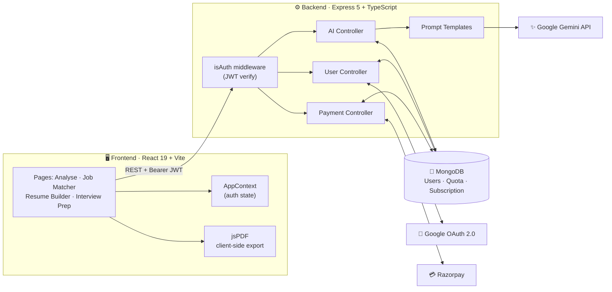
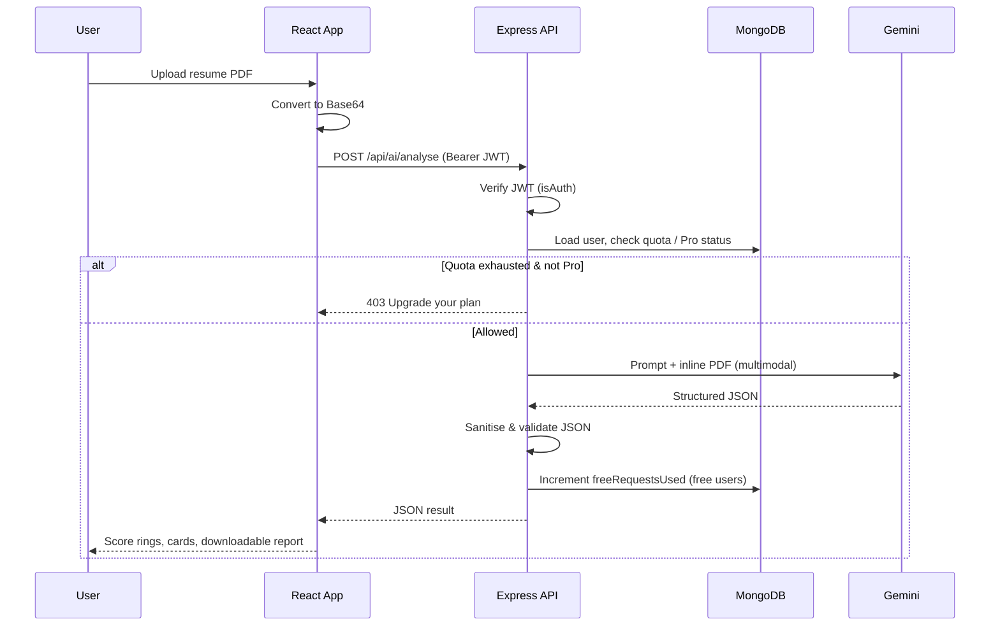

<div align="center">

# 🚀 NextRole AI

### The AI-powered career copilot that takes you from **resume → offer letter**

Analyse your resume against ATS systems, discover roles that actually fit, generate a recruiter-ready resume, and rehearse interviews — all in one full-stack platform.

<br/>


[✨ Features](#-features) •
[🏗️ Architecture](#️-architecture) •
[🧰 Tech Stack](#-tech-stack) •
[⚡ Getting Started](#-getting-started) •
[🔌 API](#-api-reference) •
[🗺️ Roadmap](#️-roadmap)

</div>

---

## 📌 Overview

Job hunting is noisy: resumes get filtered by ATS bots before a human reads them, people apply blindly to roles that don't fit, and interview prep is generic.

**NextRole AI** tackles all four problems in one product. Users sign in with Google, upload a PDF resume (or enter their skills manually), and Google **Gemini** returns **structured, actionable JSON** that the UI renders as score rings, match cards, downloadable reports and ready-to-print resumes.

It is a production-style full-stack app with **OAuth authentication, JWT-protected APIs, a freemium usage quota, and real payments via Razorpay**.

---

## ✨ Features

| | Module | What it does |
|---|---|---|
| 📊 | **AI Resume Analyser** | Upload a PDF and get an **ATS score (0–100)** with a breakdown across *formatting, keywords, structure and readability*, prioritised suggestions (🔴 high / 🟡 medium / 🟢 low) and strengths. Export the full report as a styled HTML file. |
| 🎯 | **Smart Job Matcher** | Extracts your profile from a resume **or** manual skills + experience and recommends the **5 best-fit roles**, each with a match %, work type, required skills, *why it matches* and a tailored *apply tip*. |
| 📝 | **AI Resume Builder** | Two modes: **build from scratch** via a guided form, or **improve an existing PDF**. Produces an ATS-optimised resume with action-verb bullets and a professional summary, exported to a clean **A4 PDF** in-browser. |
| 🎤 | **Interview Prep** | Generates **10 progressively harder questions** with answer hints and categories, for either an **HR/behavioural** or **technical** round, based on your resume or skills. Download as PDF. |
| 🔐 | **Google Sign-In** | One-click OAuth 2.0 login, JWT sessions (15-day expiry), protected & public route guards. |
| 💳 | **Freemium + Payments** | 3 free AI requests per user, then upgrade to **Pro Monthly (₹299)** or **Pro 6-Month (₹1,499)** through Razorpay with server-side signature verification. |

---

## 🏗️ Architecture



### 🔄 Request lifecycle (AI endpoints)



---

## 🧠 Engineering Highlights

- **Multimodal LLM pipeline** — PDFs are sent directly to Gemini as inline data, so no brittle PDF-parsing step; prompts enforce a strict JSON schema so responses map straight onto typed React components.
- **Defensive AI handling** — responses are stripped of markdown fences, JSON-parsed in a guarded block, and empty/invalid outputs return clear errors without consuming the user's quota.
- **Usage metering built into the data model** — `hasProAcess()` and `canMakeRequest()` live on the Mongoose schema, keeping quota logic in one place across all four AI endpoints.
- **Secure payments** — orders are created server-side; on completion the **HMAC-SHA256 signature is verified** with the Razorpay secret before the subscription expiry is written.
- **Auth done properly** — Google OAuth authorization-code flow → JWT; every AI and payment route sits behind an `isAuth` middleware; frontend uses `ProtectedRoutes` / `PublicRoutes` guards.
- **Zero-server exports** — resume and interview PDFs are generated entirely in the browser with **jsPDF** (lazy-loaded to keep the initial bundle small).
- **End-to-end TypeScript** — shared domain models (`Analysis`, `ResumeData`, `InterviewData`, `Job`) typed on the client; typed Express request extensions on the server.

---

## 🧰 Tech Stack

**Frontend**
- React 19, TypeScript, Vite
- Tailwind CSS v4
- React Router v7, Context API
- `@react-oauth/google`, Axios, react-hot-toast, Lucide icons
- jsPDF for client-side PDF generation

**Backend**
- Node.js, Express 5, TypeScript (ES modules)
- MongoDB + Mongoose
- Google Gemini via `@google/genai`
- Google OAuth (`googleapis`), JSON Web Tokens
- Razorpay SDK

---

## 📁 Project Structure

```
AI-Careers/
├── backend/
│   └── src/
│       ├── config/          # db, Google OAuth client, Gemini prompt templates
│       ├── controllers/     # ai · user · payment
│       ├── middlewares/     # isAuth (JWT), trycatch (async error wrapper)
│       ├── models/          # User schema + subscription/quota methods
│       ├── routes/          # /api/ai · /api/user · /api/payment
│       └── index.ts         # app entry
└── frontend/
    └── src/
        ├── components/      # navbar, hero, features, pricing, route guards…
        ├── context/         # AppContext (auth + user state)
        ├── pages/           # Home, Login, Analyse, JobMatcher,
        │                    # BuildResume, Interview, Account
        ├── types.ts         # shared TypeScript models
        └── utils.ts         # plans, PDF/report generators, helpers
```

---

## ⚡ Getting Started

### Prerequisites
- Node.js 20+
- A MongoDB database (local or Atlas)
- [Google Cloud OAuth credentials](https://console.cloud.google.com/apis/credentials)
- A [Gemini API key](https://aistudio.google.com/app/apikey)
- A [Razorpay](https://razorpay.com/) account (test mode is fine)

### 1. Clone

```bash
git clone https://github.com/<your-username>/NextRole-AI.git
cd NextRole-AI/AI-Careers
```

### 2. Backend

```bash
cd backend
npm install
```

Create `backend/.env`:

```env
PORT=5000
MONGO_URI=<your-mongodb-connection-string>
GOOGLE_CLIENT_ID=<your-google-oauth-client-id>
GOOGLE_CLIENT_SECRET=<your-google-oauth-client-secret>
JWT_SEC=<a-long-random-secret>
API_KEY_GEMINI=<your-gemini-api-key>
Razorpay_Key=<your-razorpay-key-id>
Razorpay_Secret=<your-razorpay-key-secret>
```

```bash
npm run build
npm start          # or: npm run dev  (watch mode)
```

### 3. Frontend

```bash
cd ../frontend
npm install
npm run dev
```

Set the API base URL (`server`) and your Google OAuth client ID to match your environment, then open **http://localhost:5173**.

> 🔒 **Never commit `.env` files.** Rotate any key that has ever been pushed to a public repository.

---

## 🔌 API Reference

All routes except `/api/user/login` require `Authorization: Bearer <JWT>`.

| Method | Endpoint | Description |
|:------:|----------|-------------|
| `POST` | `/api/user/login` | Exchange Google auth code for a JWT + user profile |
| `GET`  | `/api/user/me` | Current user, subscription & quota |
| `POST` | `/api/ai/analyse` | ATS analysis of an uploaded PDF resume |
| `POST` | `/api/ai/job-matcher` | Top 5 role matches (`mode`: `manual` \| `resume`) |
| `POST` | `/api/ai/interview` | 10-question HR or technical set (`round`: `hr` \| `technical`) |
| `POST` | `/api/ai/resume-build` | Generate or improve a resume (`mode`: `manual` \| `improve`) |
| `POST` | `/api/payment/checkout` | Create a Razorpay order for a plan |
| `POST` | `/api/payment/verify` | Verify payment signature and activate Pro |

<details>
<summary><b>Example response — <code>POST /api/ai/analyse</code></b></summary>

```json
{
  "atsScore": 85,
  "scoreBreakdown": {
    "formatting":  { "score": 90, "feedback": "Clean single-column layout." },
    "keywords":    { "score": 80, "feedback": "Missing several role-specific terms." },
    "structure":   { "score": 85, "feedback": "Standard section headings used." },
    "readability": { "score": 88, "feedback": "Concise, action-oriented bullets." }
  },
  "suggestions": [
    {
      "category": "Keywords",
      "issue": "No mention of CI/CD tooling",
      "recommendation": "Add relevant tools you've used, e.g. GitHub Actions.",
      "priority": "high"
    }
  ],
  "strengths": ["Quantified achievements", "ATS-safe formatting"],
  "summary": "A strong resume that would benefit from richer keyword coverage."
}
```
</details>

---

## 🗺️ Roadmap

- [ ] Persist analysis & interview history per user
- [ ] Interactive mock-interview mode with AI answer feedback
- [ ] Job-description ↔ resume tailoring (keyword gap vs. a pasted JD)
- [ ] Rate limiting, request validation (Zod) and Razorpay webhooks
- [ ] Multiple resume templates and DOCX export
- [ ] Dockerised deployment + CI pipeline
- [ ] Unit & integration tests

---

## 🤝 Contributing

Contributions, issues and feature requests are welcome!

1. Fork the repo
2. Create your branch: `git checkout -b feature/amazing-feature`
3. Commit: `git commit -m "feat: add amazing feature"`
4. Push: `git push origin feature/amazing-feature`
5. Open a Pull Request

---

## 👤 Author

**Himanshu Meshram**

[](https://github.com/Himanshu-dev02)
[](https://www.linkedin.com/in/%20himanshu-meshram-hm)
[](meshramhimanshu20@gmail.com)

---

<div align="center">

⭐ **If you found this project useful, please consider giving it a star!** ⭐

</div>